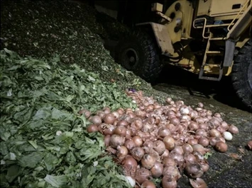
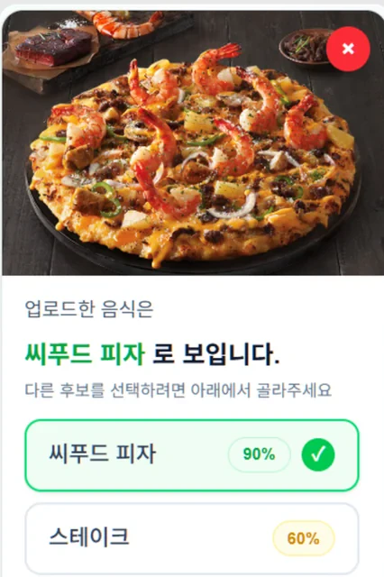

# 주연석

### AI 모델과 웹 서비스를 만듭니다.

데이터 수집 · 모델링 · 웹 연동 · 배포

 

<a href="https://pollux-o4.github.io/itIsMe/"><b>포트폴리오 보기 →</b></a>

<a href="https://github.com/pollux-o4">GitHub</a>

 

 

## 대표 작업

<table>
<tr>
<td width="33%" valign="top">

 <b>농산물 가격 예측</b>
 시계열 데이터로 다음 가격을 예측
</td>
<td width="33%" valign="top">

 <b>항공기 엔진 수명 예측</b>
 센서 신호로 남은 수명을 추정
</td>
<td width="33%" valign="top">

 <b>음식 사진 분석 앱</b>
 사진 한 장으로 영양 정보를 계산
</td>
</tr>
</table>

 
자세한 과정과 결과는 <a href="https://pollux-o4.github.io/itIsMe/">포트폴리오</a>에서 볼 수 있습니다.

