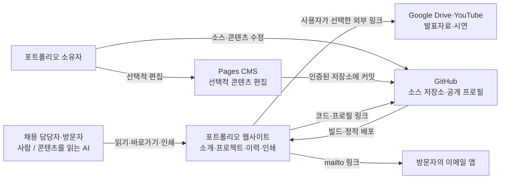

# C1 · Context

범위: 주연석 포트폴리오 웹사이트. 독자는 짧은 소개에서 역할·작업·근거를 확인하고 전체 인쇄본을 저장한다.

외부 발표자료는 링크로 연다. 사이트 자체에 로그인·API 서버·데이터베이스·메일 발송 서버는 없다. 원본 개인정보 자료는 Git·공개 빌드에서 제외한다. CMS 인증·저장은 소유자의 계정 연결이 필요하다.

다음: [C2 컨테이너](02-containers.md).
