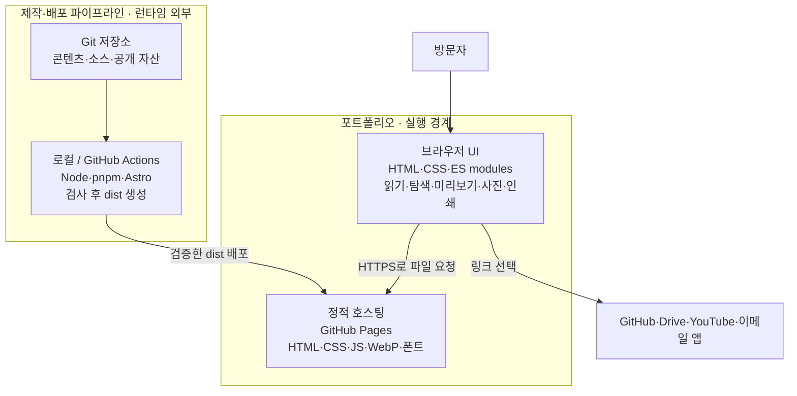

# C2 · Container

방문자 브라우저에서 정적 HTML·CSS와 작은 TypeScript 번들을 실행한다. GitHub Pages는 정적 파일을 제공한다. Astro는 개발·CI의 빌드 도구이며 배포 후 서버로 실행되지 않는다.

| 경계 | 구현 |
|---|---|
| 정적 생성·URL 기준 경로 | [astro.config.mjs](../../astro.config.mjs) |
| 빌드·검사 명령 | [package.json](../../package.json) |
| main 배포 | [GitHub Actions](../../.github/workflows/deploy.yml) |
| 선택적 Git 기반 편집 | [.pages.yml](../../.pages.yml) |

`/about/`, `/work/`는 정본의 앵커로 연결된다. `/notes/`, 공개된 Markdown 작업 상세, 404는 보조 레이아웃을 사용한다. 현재 미공개 샘플은 빌드에 포함하지 않는다. 로컬 개발 서버는 배포 컨테이너가 아니다.

다음: [C3 컴포넌트](03-components.md).
