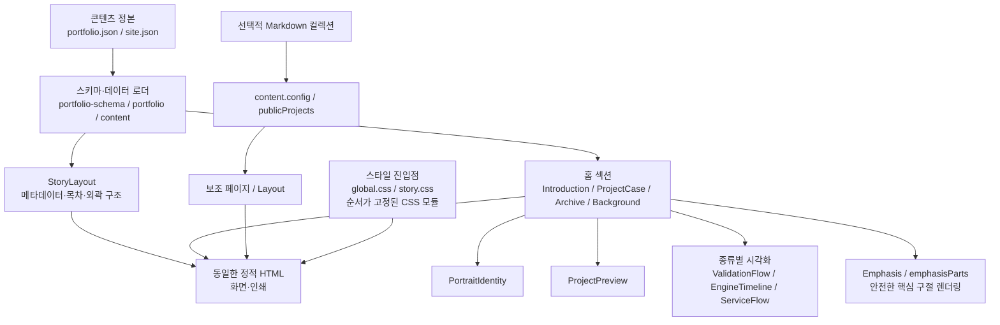
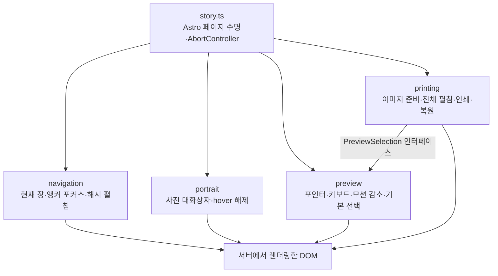

# C3 · Component

## Astro 정적 생성 내부

`index.astro`는 섹션 순서만 조합한다. 사례의 공통 구조·근거는 `ProjectCase`, 종류별 그림은 시각화 레지스트리가 담당한다. 프로젝트 제목·목차·짧은 역할·미리보기 설정·추가 링크는 콘텐츠 정본에서 읽는다. 서로 다른 길이의 편집용 라벨은 별도 필드로 명시한다.

## 브라우저 UI 내부

`printing`은 미리보기 내부 DOM을 검색하지 않고 `selected / select / reset`만 사용한다. 각 초기화는 동일한 `AbortSignal`을 받아 페이지 교체 시 이벤트·예약 프레임·열린 대화상자를 정리한다. 인쇄는 기존 펼침·선택 상태를 저장했다가 복원한다. 미리보기 기본 ID는 `data-preview-default`에서 읽는다.

CSS 파일을 나누면서 기존 규칙 순서를 유지했다. 인쇄와 모바일 규칙이 앞선 기본 규칙을 보완하는 순서도 공개 인터페이스의 일부다. 순서 변경은 화면·인쇄 회귀 확인이 필요하다.

다음: [C4 코드 경로](04-code.md).
