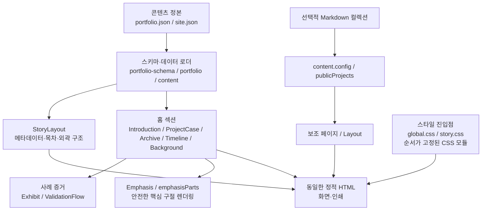
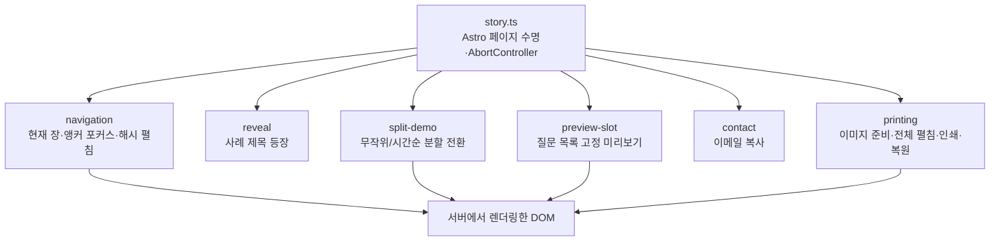

# C3 · Component

## Astro 정적 생성 내부

`index.astro`는 섹션 순서만 조합한다. 사례의 공통 구조는 `ProjectCase`, 증거 그림은 `Exhibit`(번호 표시가 있는 발표자료 크롭)과 분할 데모가 담당한다. 프로젝트 제목·목차·짧은 역할·답하는 채용 질문·사례 흐름(문제→판단→실행→검증→남은 과제)·역할 구분·목록 이미지·추가 링크는 콘텐츠 정본에서 읽는다. 서로 다른 길이의 편집용 라벨은 별도 필드로 명시한다.

## 브라우저 UI 내부

각 초기화는 동일한 `AbortSignal`을 받아 페이지 교체 시 이벤트·예약 프레임을 정리하고 정적 HTML 상태로 되돌린다. 분할 데모는 스크립트가 없으면 최종 상태(시간순 분할)를 보여 준다. 인쇄는 펼침 상태를 저장했다가 복원한다. 질문 목록의 미리보기는 고정된 칸 안에서만 바뀌고 글 위에 뜨지 않는다. 각 요소의 위치와 이유는 [화면 명세](../design/SPEC.md)에 있다.

스타일은 `tokens → base → masthead → hero → case → visuals → sections → contact → print` 순서로 가져온다. 색은 토큰으로만 쓰며, `.is-night` 장은 같은 토큰을 다시 정의해 컴포넌트 수정 없이 어두운 면이 된다. 인쇄 규칙이 마지막에 앞선 규칙을 덮는 순서도 공개 인터페이스의 일부다.

다음: [C4 코드 경로](04-code.md).
